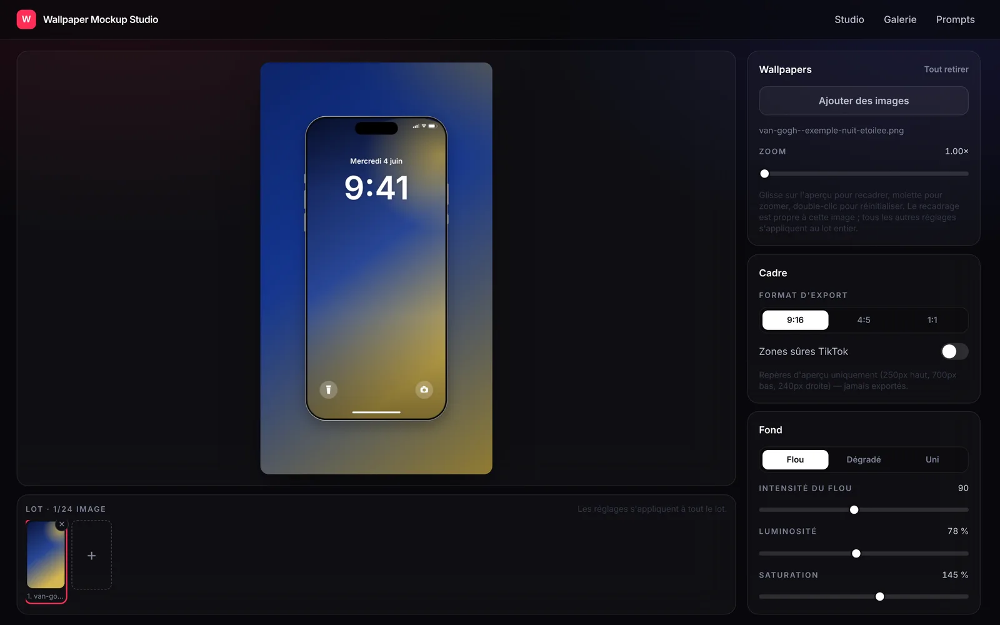
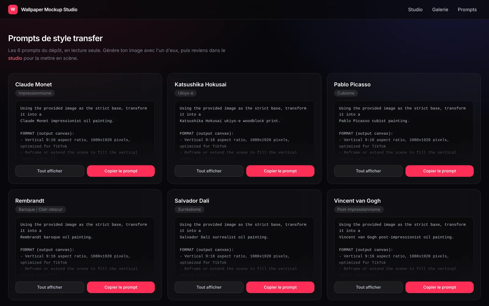
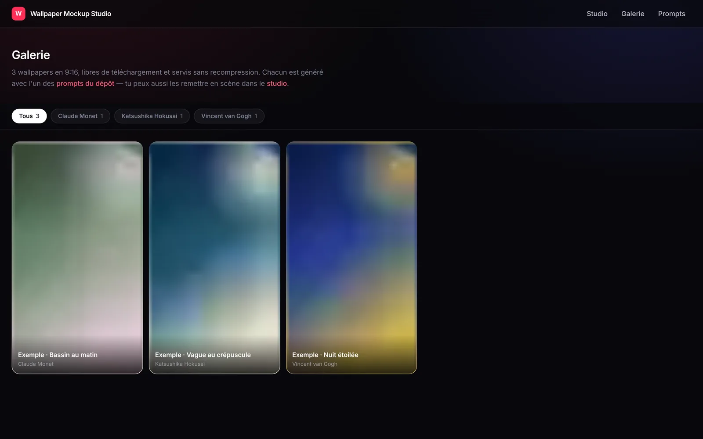

<div align="center">

# 🎨 Painter Style Transfer

**Transforme un personnage en tableau de maître, mets-le en scène sur un iPhone, puis donne-lui de la profondeur.**

Six prompts img2img soignés · un studio web pour créer des mockups de fonds d'écran · un microservice de vidéo parallaxe 3D.




</div>

---

## ✨ En bref

| | |
|---|---|
| 🖌️ **Prompts** | 6 prompts de *style transfer* (Van Gogh, Monet, Picasso, Hokusai, Rembrandt, Dalí) qui changent le rendu **sans toucher à l'identité** du personnage |
| 📱 **Studio** | Glisse une image : elle apparaît sur un écran verrouillé d'iPhone, sur un fond flouté tiré de l'image. Export JPG/PNG en 1080×1920, traitement par lots en ZIP |
| 🌄 **Parallaxe** | Une image fixe devient une vidéo MP4 en 3D grâce à une estimation de profondeur, avec un aperçu WebGL en temps réel dans le navigateur |
| 🖼️ **Galerie** | Une vitrine des wallpapers générés, filtrable par peintre, téléchargeables en qualité d'origine |

Tout est pensé pour le **format vertical 9:16** (Reels, Shorts, TikTok).

## 📸 Aperçu

<table>
  <tr>
    <td width="50%"></td>
    <td width="50%"></td>
  </tr>
  <tr>
    <td align="center"><b>Prompts</b>, consultables et copiables en un clic</td>
    <td align="center"><b>Galerie</b>, filtrable par peintre</td>
  </tr>
</table>

## 🖌️ Les prompts

| Peintre | Mouvement | Fichier |
|---|---|---|
| Vincent van Gogh | Post-impressionnisme | [`prompts/van-gogh.md`](prompts/van-gogh.md) |
| Claude Monet | Impressionnisme | [`prompts/claude-monet.md`](prompts/claude-monet.md) |
| Pablo Picasso | Cubisme | [`prompts/pablo-picasso.md`](prompts/pablo-picasso.md) |
| Katsushika Hokusai | Ukiyo-e (estampe japonaise) | [`prompts/hokusai.md`](prompts/hokusai.md) |
| Rembrandt | Baroque, clair-obscur | [`prompts/rembrandt.md`](prompts/rembrandt.md) |
| Salvador Dalí | Surréalisme | [`prompts/salvador-dali.md`](prompts/salvador-dali.md) |

Chaque prompt suit la même structure, **Keep / Change / How / Constraints** :

- **FORMAT** : toile verticale 9:16 (1080×1920), avec des marges qui évitent les zones recouvertes par l'interface des applis vidéo (250 px en haut, 700 px en bas, 240 px à droite)
- **PRESERVE** : ce qui ne doit pas bouger (visage, proportions, pose, expression, tenue)
- **APPLY** : technique, palette, texture et ambiance du peintre, décrites par leurs caractéristiques plutôt que par le seul nom de l'artiste
- **CONSTRAINTS** : seul le rendu change ; ni texte, ni signature, ni watermark, ni bordure

### 💡 Conseils d'utilisation

- **img2img** : un *denoising strength* entre 0.3 et 0.5 impose le style sans déformer le sujet
- **Itérer** : changer une seule variable à la fois (la palette, puis l'intensité des coups de pinceau) et noter prompts et seeds
- **Negative prompt** (si le modèle le gère) : `text, watermark, signature, distorted face, extra limbs`
- **Langue** : les prompts sont en anglais, ce qui donne de meilleurs résultats sur la plupart des modèles
- **Composition** : si l'image source n'est pas verticale, le prompt demande d'étendre le décor dans le style du peintre (*outpainting*) plutôt que de recadrer le personnage

> **Picasso et Dalí** déforment la géométrie par nature : leur bloc PRESERVE vise à garder le personnage *reconnaissable* plutôt qu'à conserver sa géométrie exacte.
> **Hokusai**, très graphique (aplats et contours), rend particulièrement bien sur les personnages au design marqué.

## 🚀 Démarrage rapide

Il suffit de Docker :

```bash
git clone <url-de-ce-dépôt>
cd painter-style-transfer-prompts
docker compose up --build
```

Puis ouvre **http://localhost:3000**.

Pour ne lancer que le studio, sans Docker (Node 22 ou plus) :

```bash
cd web
npm install
npm run dev
```

Le panneau parallaxe affiche simplement un message de repli tant que le service n'est pas lancé.

## 🏗️ Architecture

```
            navigateur
                │  (une seule origine)
                ▼
   ┌────────────────────────┐   réseau Docker interne   ┌──────────────────────┐
   │  studio · Next.js      │ ────── /api/parallax/* ──▶ │  parallax · FastAPI  │
   │  mockups, galerie,     │                            │  DepthFlow + torch   │
   │  prompts               │                            │  (CPU), ffmpeg       │
   └────────────────────────┘                            └──────────────────────┘
```

- **Le studio fonctionne entièrement dans le navigateur** : les images déposées ne quittent la machine que si tu lances un rendu parallaxe.
- **Le service parallaxe reste privé** : le studio relaie les appels côté serveur, donc pas de CORS et pas de domaine public à exposer.
- **L'aperçu live** récupère une seule fois la carte de profondeur (`/depth`), puis anime un *displacement* WebGL avec la même trajectoire de caméra que le rendu final. Le MP4 (`/render`) n'est généré qu'une fois le réglage validé.

| Dossier | Contenu |
|---|---|
| [`prompts/`](prompts/) | Les six prompts, la source de vérité |
| [`web/`](web/) | Wallpaper Mockup Studio (Next.js 16, React 19, Tailwind 4, tests Playwright) |
| [`parallax/`](parallax/) | Microservice image vers vidéo parallaxe ([DepthFlow](https://github.com/BrokenSource/DepthFlow), FastAPI, tests pytest) |
| [`docs/`](docs/) | Captures d'écran et [guide de déploiement](docs/deploiement.md) |

## ⚙️ Configuration

Aucune variable n'est obligatoire. Voir [`.env.example`](.env.example) pour la liste complète.

| Variable | Défaut | Rôle |
|---|---|---|
| `PARALLAX_INTERNAL_URL` | `http://parallax:8100` | Adresse du service parallaxe, vue depuis le studio |
| `STUDIO_PORT` / `PARALLAX_PORT` | `3000` / `8100` | Ports publiés en local |
| `LOG_LEVEL` | `warn` / `warning` | Verbosité des logs |

Pour mettre la pile en production derrière un reverse proxy (exemple avec Dokploy et Traefik), voir le **[guide de déploiement](docs/deploiement.md)**.

## 🧪 Tests

```bash
cd web && npm run lint && npm run typecheck && npm run test:e2e
cd parallax && pytest
```

## 📄 Licence

Distribué sous licence [MIT](LICENSE).

---

<div align="center">
<sub>Projet personnel, des prompts au rendu vidéo.</sub>
</div>
